# LUMEN — Examen parcial I (modalidad individual)

Proyecto base: abrir `index.html` en un navegador; no instalar dependencias. Lea el enunciado del examen antes de modificar archivos. Conserve el proyecto inicial en el primer commit.

## Identificación

Estudiante: **Dariel Calvo Brenes** | Grupo: **002** | Repositorio público: **https://github.com/Darieles01/LUMEN_estudiante**

## Diagnóstico de incidencias
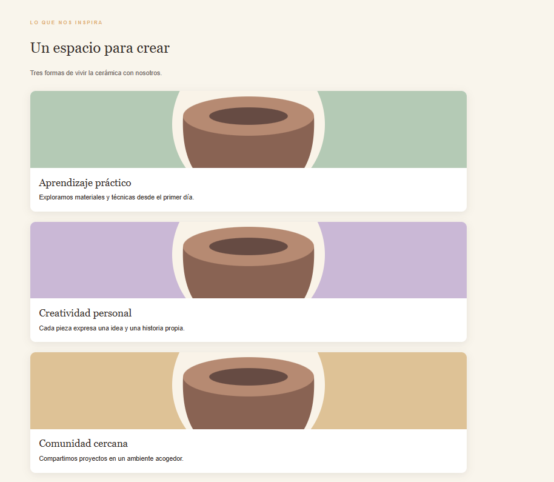
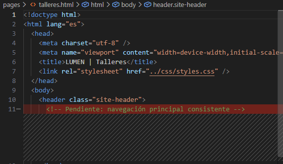
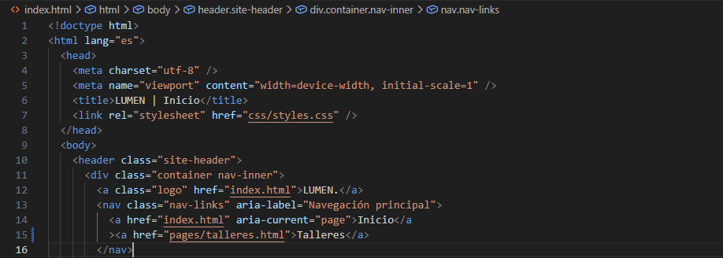
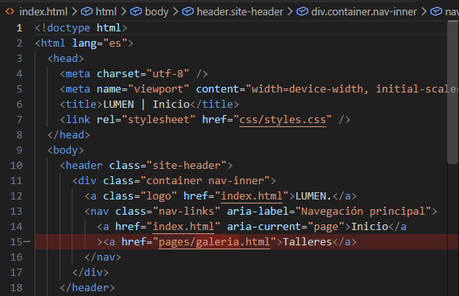

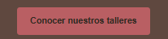
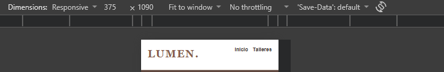

### Incidencia A

- Antes:
  
- Ubicación y causa: la causa es flex-direction: column;
  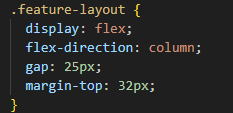
- Corrección:
  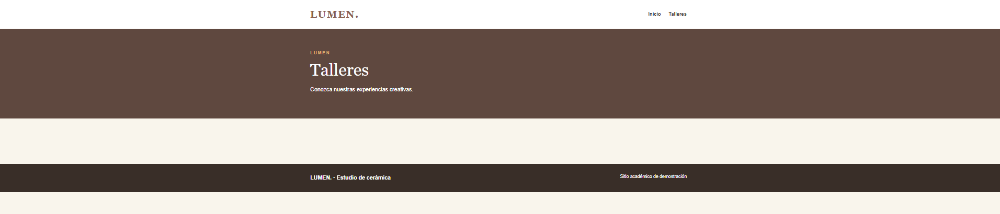
- Prueba:
- Capturas:
  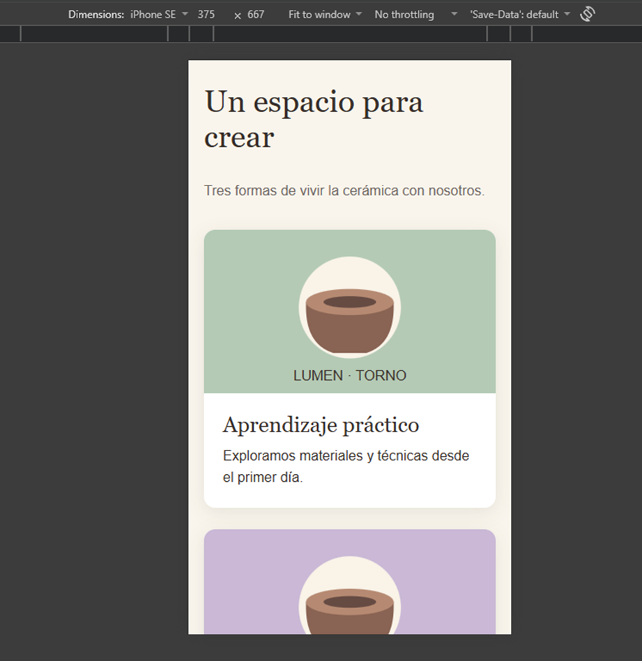
  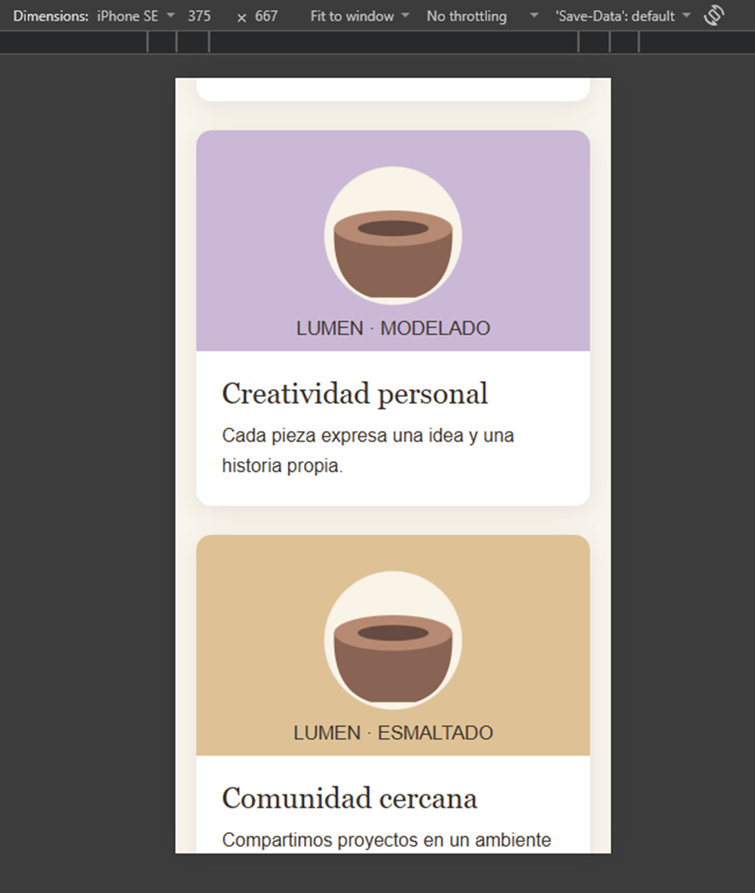
  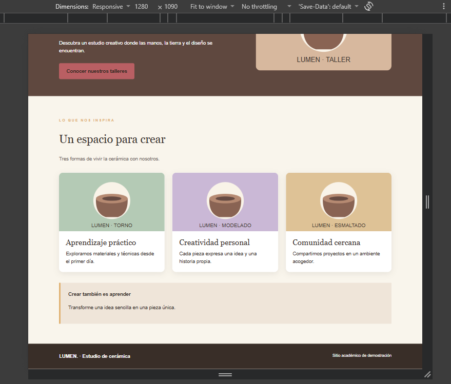

### Incidencia B

- Antes:
  
  
  
- Ubicación y causa: En galery.html y talleres.html era solo agregar el header, y en index.html era cambiar href="pages/galery.html" por href="pages/talleres.html"
  
  
  
- Corrección:
  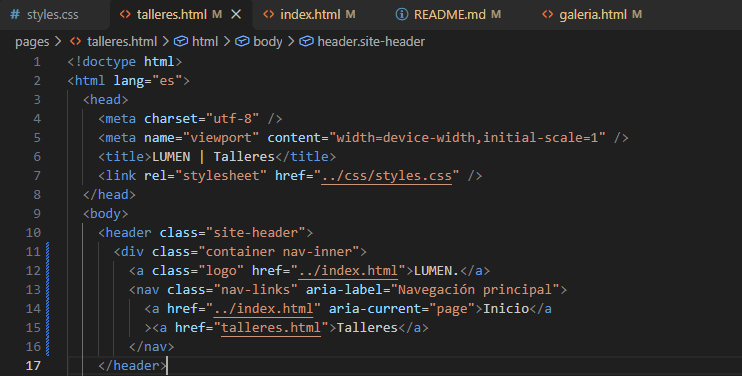
  
  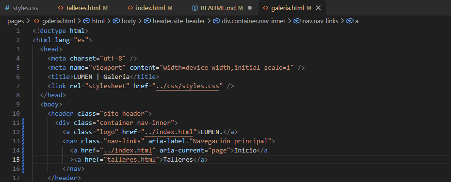
- Prueba:
  
- Capturas:

### Incidencia C

- Antes:
  
- Ubicación y causa: El boton tenia href # habia que cambiarlo a href pages/talleres.html
  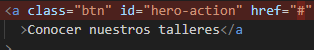
- Corrección:
  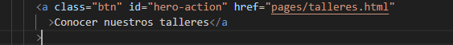
- Prueba:

### Incidencia D

- Antes:
  
- Ubicación y causa: se ubica en styles.css y la causa es porque el boton tiene un id y una clase pero en styles se usan los dos pero como id tiene mas peso que la clase entonces se aplica primero el #hero-action
  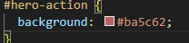
- Corrección: Eliminar esas lineas de codigo (el #hero-action)
- Prueba:
  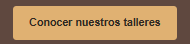
- Capturas:

### Incidencia E

- Antes:
  
- Ubicación y causa: La causa se debe a que hay otro querry que choca con lo pedido en el incidente E
  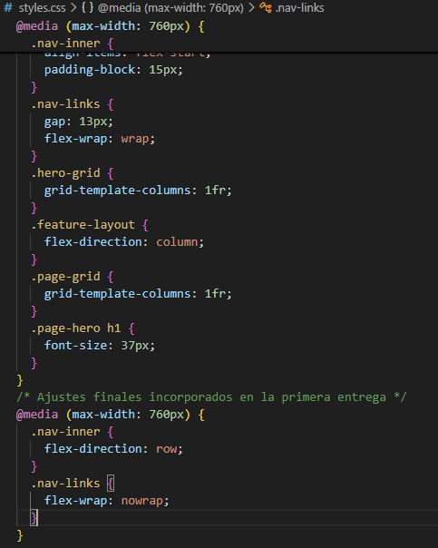
- Corrección: Eliminar la querry extra
- Prueba:
  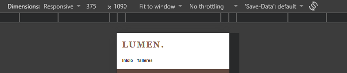
- Capturas:
  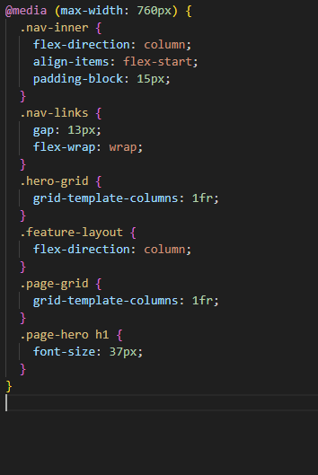

## Funcionalidad individual
La pagina creada sigue la estructura de styles.css, en el otro css solo le di diseño a los elementos de talleres.html.
La navegacion interna son tres botones al principio del main, despues del header y tienen su propio diseño y utilizan hover.
Para esta pagina se utilizo las variables del styles.css.
Para la responsividad se utiliza una querry, la cual empieza desde 760px y lo que hace es acomodar las tarjetas de las tecnicas de forma vertical y acomodar un poco los margenes.

## Evidencias Git / GitHub

- URL repositorio: https://github.com/Darieles01/LUMEN_estudiante
- Commits significativos y ramas: Todos los commits son significativos excepto el primero de ramaf1 y las ramas fueron ramaf1 ramabugs y develop
- PR ramabugs → develop (enlace): https://github.com/Darieles01/LUMEN_estudiante/pull/1
- PR ramaf1 → develop (enlace): https://github.com/Darieles01/LUMEN_estudiante/pull/2
- Auto-revisión de cada PR (comentarios, lista de pruebas y correcciones antes del merge): Todo perfecto
- PR develop → main (enlace): https://github.com/Darieles01/LUMEN_estudiante/pull/3
- Resultado de cada merge; conflictos reales y resolución, o indicar integración sin conflictos: integracion sin conflictos

## Pruebas y entrega

Registrar navegación, imágenes, 1280 px, 375 px, procedimiento para abrir, URL de repo y nombre del ZIP.
Toda la navegacion y procedimientos para abrir es muy intuitiva.
Nombre del ZIP: LUMEN_estudiante.zip
Imagenes:
<video controls src="20261023-0031-10.1743345.mp4" title="Title"></video>
